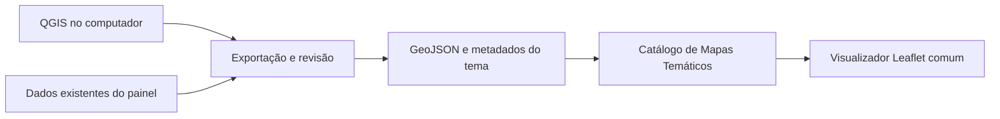

# Mapas Temáticos da Sala de Situação de Unaí

Data: 10/10/2026. Estado: proposta de arquitetura para revisão; implementação ainda não iniciada.

## Propósito acordado

Preparar uma área própria de Mapas Temáticos dentro do domínio existente da Sala de Situação. Os mapas serão produzidos localmente no QGIS e publicados para consulta interativa. O mapa de unidades e serviços já utilizado no Painel de Monitoramento será o primeiro caso de teste do visualizador comum. Novos temas serão incluídos quando houver dados e cartografia revisados.

Requisito obrigatório: custo adicional zero. Reaproveitar computador, QGIS, domínio e hospedagem existentes. Não contratar servidores, serviços de mapas, assinaturas, APIs pagas nem habilitar cobrança ou atualização de plano. Se um recurso ultrapassar as condições gratuitas, reduzir ou adiar esse recurso.

## Situação local verificada

- `expansao/portal` gera páginas HTML reais. `/mapas-de-saude/` atualmente encaminha para o Busca Saúde no painel.
- `expansao/painel` é o publicador modular; possui os destinos `/` e `/painel-de-monitoramento/`. A página de mapas será um módulo funcional do portal, sem exigir outro domínio ou repositório externo.
- `expansao/painel/public/data/mapa-servicos.json` contém 32 locais e quatro camadas de contexto. Coordenadas e geometrias estão em SIRGAS 2000 / UTM 23S, EPSG:31983.
- Grupos presentes: 18 locais UBS/ESF, cinco de saúde especializada e gestão, três de urgência e emergência, quatro de proteção social e dois de segurança pública.
- Fonte documental dos endereços: consulta de 09/09/2026. São locais geocodificados, aproximados e sem validação operacional. Os 23 registros de ESF da referência foram agrupados em 18 locais; locais não equivalem a equipes.
- Cartografia: malhas municipais/estaduais IBGE 2025 e área urbanizada IBGE 2019. Área urbanizada não equivale ao perímetro urbano legal atual. Não há limites oficiais de bairros ou áreas vigentes de equipes.
- O mapa atual possui interações implementadas em SVG pelo próprio painel. O novo piloto introduzirá Leaflet numa página separada e permitirá comparar as duas apresentações.

## Escolha técnica e alternativas

Escolha: QGIS/GDAL para preparar as camadas e Leaflet 1.9.4, versão estável indicada na documentação oficial consultada, como visualizador comum. Os dados vetoriais de publicação serão GeoJSON em EPSG:4326, com coordenadas em longitude/latitude. Originais projetados serão preservados.

O qgis2web é uma alternativa para exportar mapas individuais e verificar quais estilos do QGIS funcionam na web. Como o propósito é manter um catálogo com vários temas e interface comum, ele não será uma dependência do visualizador inicial. OpenLayers é uma alternativa para requisitos geográficos mais complexos, mas o piloto de pontos e polígonos não exige essa ampliação.

O Leaflet será distribuído com o próprio site, com licença e versão registradas. O navegador buscará scripts, estilos e camadas na mesma origem. Nenhum mapa de fundo remoto, geocodificador ou chave de API será necessário no piloto.

Documentação consultada:

- https://leafletjs.com/download.html
- https://leafletjs.com/examples/geojson/
- https://github.com/qgis2web/qgis2web
- https://docs.qgis.org/3.44/en/docs/user_manual/managing_data_source/create_layers.html

## Organização da área de mapas

1. `/mapas-de-saude/` terá o catálogo de temas disponíveis, o primeiro mapa e a navegação institucional já utilizada pelo portal.
2. O tema inicial será “Rede de saúde e serviços de referência”. Seu estado será identificado como piloto local durante a revisão.
3. Um visualizador comum carregará camadas, apresentação e metadados do tema escolhido. Incluir outro tema dependerá de cadastrar arquivos e configurações, sem duplicar o motor do mapa.
4. Temas futuros sem dados não aparecerão como mapas disponíveis. A interface explicará que novos temas serão incorporados após revisão.
5. O Painel de Monitoramento continuará com sua rota e apresentação atuais nesta etapa. O piloto reutilizará a mesma fonte documental em arquivos derivados separados.

## Pacote de cada tema

Os arquivos ficarão na área de mapas do portal, separados dos dados do painel. Cada tema terá:

- Identificador estável, título, descrição e estado de disponibilidade.
- Lista de camadas com caminho local, tipo geométrico, visibilidade inicial e campos permitidos na consulta.
- Fonte, período de referência, data de preparação/publicação, licença quando disponível e limitações.
- Cores, formas, legenda e ordem das camadas. A exportação de GeoJSON não transporta automaticamente toda a simbologia do QGIS.
- Enquadramentos e limites da navegação definidos com base nas geometrias, incluindo município e sede urbana.
- Método de preparação, CRS da origem, CRS publicado e hashes dos arquivos de origem e derivados.

São permitidos pontos, linhas e polígonos. Indicadores numéricos futuros poderão usar faixas de cores definidas na configuração, com classe explícita para valores ausentes. Imagens raster, mapas de calor e séries temporais ficam para uma etapa em que exista um tema concreto que precise desses recursos.

## Piloto com os locais existentes

- Preservar os 32 identificadores e atributos públicos, inclusive observações sobre divergências e qualidade da localização.
- Separar visualmente os cinco grupos existentes. Os três grupos de saúde começarão visíveis; proteção social e segurança pública poderão ser ativados como referência.
- Usar limite municipal e área urbanizada como base local. Camadas de contexto regional existentes poderão ser alternadas sem depender de mapas de fundo remotos.
- Oferecer zoom, arraste, controles por teclado, escolha de camadas e enquadramentos municipal e urbano.
- Permitir busca por nome e bairro, filtro por grupo e lista de locais equivalente aos pontos filtrados. Clique no mapa e seleção na lista deverão abrir a mesma informação.
- Exibir nome, grupo, endereço, bairro quando presente, qualidade de geocodificação e observação original. Campos vazios não receberão valores inventados.
- Mostrar legenda, fonte, período e limitações junto ao mapa. Quantidades serão rotuladas como locais, sem assumir número de equipes ou cobertura assistencial.
- Oferecer download do GeoJSON e dos metadados do tema, com os mesmos atributos públicos revisados.

## Preparação local e manutenção

No piloto, derivar GeoJSON da fonte pública existente. A transformação EPSG:31983 → EPSG:4326 usará QGIS/GDAL local, com conferência das coordenadas e registro do processamento. Não recalcular geocodificação, deslocar pontos ou alterar endereços.

Nos próximos temas, preparar e revisar as camadas no QGIS, exportar somente os atributos aprovados e registrar as regras da legenda. Manter projetos QGIS/GeoPackage originais no acervo e publicar apenas derivados apropriados para a web.

Os derivados serão gerados no computador e verificados antes de entrar no pacote do site. A hospedagem servirá arquivos estáticos; não precisará executar QGIS ou manter um banco geográfico. Atualizações locais exigirão nova exportação, revisão e publicação.

## Carregamento e falhas

Carregar apenas as camadas do tema selecionado. Se um arquivo não estiver disponível ou tiver formato inválido, mostrar o erro de forma explícita, mantendo fonte e descrição acessíveis. Não substituir um mapa ausente por dados fictícios.

A lista dos locais e o contexto documental deverão permanecer acessíveis quando a visualização não puder ser inicializada. Os arquivos de terceiros serão locais e versões fixadas; não exigir acesso a uma CDN durante a consulta.

## Integração e etapas

Etapa inicial: desenvolver e revisar localmente em área isolada do portal. A página de Mapas substituirá seu encaminhamento atual pelo catálogo e piloto. Manter cabeçalho, rodapé, acessibilidade e identidade visual institucional.

Etapa seguinte: gerar o pacote integrado do publicador, validar rotas, políticas de publicação e preservação dos dados do painel. Somente depois de revisar uma versão concreta poderá ser proposta homologação externa. A ativação no domínio principal será uma decisão específica posterior, sem acionar publicação automaticamente nesta implementação.

## Critérios de aceitação

1. O piloto abre na página própria de mapas e usa Leaflet, com controles funcionais no computador e no celular.
2. Os 32 locais são preservados; o estado inicial exibe os 26 locais dos três grupos de saúde. Ativar as duas camadas de referência permite consultar os outros seis.
3. Filtros, busca, lista e seleção de pontos são coerentes. Mudanças de enquadramento não alteram os dados.
4. A reprojeção possui verificações de posição e correspondência dos identificadores; não ocorre inversão longitude/latitude.
5. Metadados, datas históricas e limitações acompanham todas as camadas. Valores ausentes não viram zero.
6. O piloto não faz requisições de recursos a serviços de mapas externos. Scripts, estilos e dados usados pelo mapa estão no pacote local.
7. Outro tema pode ser incluído pela configuração e pelos arquivos próprios, sem copiar o código do visualizador.
8. JSON originais, projetos QGIS e conteúdo do painel não são modificados. Conferir hashes antes e depois.
9. Testes de dados, catálogo, rotas e integração passam; revisão visual confere telas larga e móvel, legenda, sobreposição de controles e mensagens de falha.
10. Nenhuma contratação, mudança de plano, nova cobrança ou publicação externa ocorre na etapa local.

## Limites do resultado

O piloto comprovará a estrutura do módulo e a consulta interativa de uma fonte já existente. Não comprovará que endereços estejam atualizados, que serviços estejam funcionando ou que equipes possuam determinada abrangência. Novos mapas epidemiológicos dependerão de conjuntos agregados, recortes, períodos e regras de interpretação definidos para cada tema.
